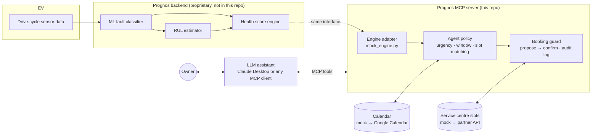
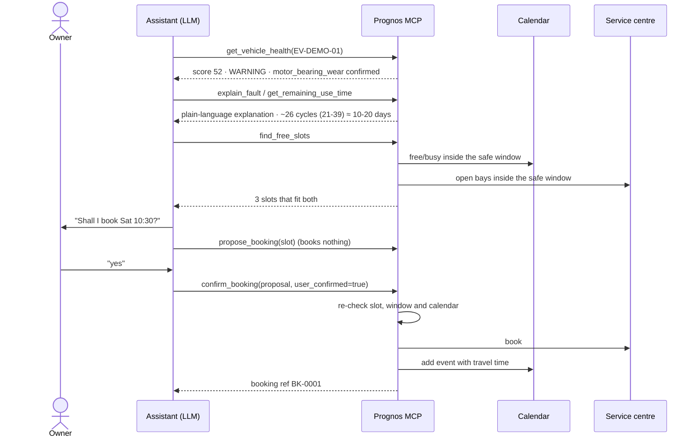
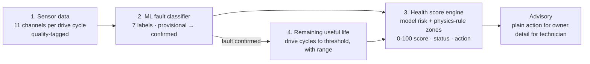

# Prognos MCP

**Your car knows it needs a service before you do. Prognos tells you in plain words and books the appointment for a time you're actually free.**

Prognos predicts electric-vehicle faults before they happen. This repository connects those predictions to the apps people already use through the [Model Context Protocol](https://modelcontextprotocol.io). An AI assistant reads the vehicle's health score and remaining useful life, explains the problem in plain language, checks your calendar and the service centre's open slots, and books a visit inside the safe window. It books only after you say yes.

> Built for the **"Make MCP Matter: less magic, more utility"** hackathon track.

> [!IMPORTANT]
> **This repo uses a mock engine.** The Prognos fault-classification model and health-score engine are the Prognos team's proprietary IP and are **not included** here. [`mock_engine.py`](src/prognos_mcp/mock_engine.py) returns realistic, scripted health scores and RUL with the same output shape. See [Ownership and IP](#ownership-and-ip).

---

## The problem

- Most EV owners find out something is wrong when a warning light comes on or the car stops. By then a cheap fix, such as a worn bearing, can turn into an expensive one, such as a damaged motor.
- Predictive maintenance exists for fleets and factories, but its output is a dashboard full of numbers. A regular person doesn't want a vibration chart. They want to know *is it serious, how long do I have, and when can I get it fixed?*
- Even when they know, booking a service means comparing their own calendar with a service centre's availability, so it gets put off.

## The idea

Close the loop from **prediction → understanding → action**, using tools the owner already has:

```
Prognos:   motor bearing wear confirmed · health 52 (WARNING) · ~26 drive cycles left (21-39)
Assistant: "The bearings that let your motor spin smoothly are wearing out. At your usual
            driving you have roughly 10-20 days. You're free Saturday at 10:30 and the service
            centre has a bay then. Shall I book it?"
You:       "yes"
Assistant: "Booked. BK-0001, Sat 09 Jan at 10:30, added to your calendar with travel time."
```

Urgency drives the tone. A vehicle that only needs watching gets a gentle suggestion. A critical one gets a clear safety message and the soonest slot, including an emergency bay.

## Architecture




### One conversation, step by step



## MCP tools

| Tool | What it does |
|---|---|
| `list_vehicles` | The owner's vehicles |
| `get_vehicle_health` | Score, status, subsystems, suspected or confirmed fault, urgency |
| `get_remaining_use_time` | RUL in drive cycles with range, plus a days conversion |
| `explain_fault` | What it is, signs, risk, the fix, what to do until then |
| `find_free_slots` | Service slots inside the safe window that fit the owner's calendar |
| `propose_booking` | Creates a proposal and books nothing |
| `confirm_booking` | Books and adds a calendar event, only with an explicit yes |
| `get_audit_log` | Everything the assistant booked or declined |
| `simulate_drive` | Demo only: move a mock vehicle forward N drive cycles |
## How the Prognos backend works


This section explains the real backend at a conceptual level. Code, trained models, exact weights, severities and tuned thresholds are not published.

The pipeline follows the processing chain of **ISO 13374** (condition monitoring and diagnostics of machines): data acquisition → data manipulation → state detection → health assessment → prognostic assessment → advisory generation.



### 1. Sensor data and data quality

Each drive cycle produces one reading across 11 channels: battery (pack voltage, state of health, cell-voltage spread, temperature), motor (winding temperature, vibration), power electronics (inverter temperature, motor current) and context (ambient temperature, load, rpm).

Every channel carries a quality tag: `observed`, `carried` (briefly forward-filled), `stale`, `missing` or `invalid`. Prognos never invents a missing value. If a sensor drops out, the affected part of the vehicle is shown as *not assessed* rather than as healthy.

### 2. ML fault classifier

A gradient-boosted model reads the vehicle's history so far and gives a probability for seven labels: `normal`, `battery_degradation`, `cell_imbalance`, `battery_overheating`, `motor_bearing_wear`, `motor_overheating` and `inverter_fault`.

- **Provisional hypothesis.** The top non-normal label is shown as "possible fault, inspection advised". The status doesn't change and no countdown is shown.
- **Confirmed fault.** The same fault has to win with high confidence on several consecutive drive cycles. Only then does the vehicle move to at least MONITOR and RUL starts.
- **Safety rule.** If inputs are stale, the classifier refuses to answer rather than guess. In testing, a long-missing channel made the model quietly predict "normal", the worst possible failure for a safety tool. The sensor rules still assess the vehicle when the model is unavailable.

### 3. Health score engine

The engine turns model output and live sensor readings into one **0–100 health score** with a plain action. It uses a hybrid approach that is common in predictive maintenance and battery management, with two opinions blended so neither can hide the other:

- **Model opinion.** Each subsystem's risk comes from the classifier's probabilities, weighted by how severe each fault is.
- **Physics-rule opinion.** Each sensor reading is placed in a zone from **A (normal) to D (fault)**. The zone edges are informed by published standards and practice: **ISO 20816-3** vibration evaluation zones (adapted from industrial machines to vehicle motors), IEC insulation thermal classes for motor winding temperature, the 80% and 70% battery state-of-health warranty lines, and battery-management practice for cell-voltage spread.
- **Fusion.** The two opinions are combined per subsystem (battery, motor, power electronics) so that a strong alarm from either side always shows. A reading in zone D caps that subsystem's score.
- **Overall score.** Subsystem scores are weighted into one number, with a guard that stops one failing subsystem from being averaged away by healthy ones.
- **Smoothing and trend.** The score drops quickly when things get worse and recovers slowly, so one good reading can't hide a real problem. A short-window slope reports *degrading* or *improving*.
- **Coverage.** A subsystem with no valid data is *not assessed* and its weight is redistributed. "All systems normal" is shown only with full coverage.

**What the score means:**

| Score | Status | What the owner sees |
|---|---|---|
| 80–100 | 🟢 HEALTHY | No action needed |
| 60–79 | 🟡 MONITOR | Book a check at your next convenient service |
| 40–59 | 🟠 WARNING | Get it inspected soon; avoid fast charging and hard acceleration |
| below 40 | 🔴 CRITICAL | Stop driving when safe and contact service |

A confirmed fault never shows as HEALTHY. Model confidence never lowers severity or cancels a sensor alarm.

### 4. Remaining useful life (RUL)

Once a fault is confirmed, Prognos follows that fault's key signal, such as vibration for bearing wear or state of health for battery degradation. It smooths and load-adjusts the signal so a single spike can't trigger anything, then projects the trend to the fault's threshold line.

- The answer is in **drive cycles**, with a low–high range sized from validation errors. The range can be wide and is not a guarantee.
- States: `before_onset` → `collecting` → `estimating` → `threshold_reached` (sticky), or `no_trend`.
- No RUL is ever shown for an unconfirmed hypothesis, and an old estimate is discarded if the fault changes.

The MCP layer converts cycles into calendar days using the owner's own driving rate, and plans against the **low end** of the range, so the booking lands before the pessimistic estimate rather than the average one.

### Honest limits

The current models were trained and tested on a synthetic fleet, with an optional check on NASA battery-ageing data. That shows the pipeline works end to end. It does not prove real-world accuracy. A pilot with real telematics data is the main gap between prototype and product (see [Roadmap](#roadmap)).

## Ownership and IP

The **Prognos fault-classification model, health-score engine, RUL method, their weights, severities, tuned thresholds, training data and the backend that serves them are proprietary intellectual property of the Prognos team.** They are not included in this repository and are not licensed by it.

What *is* here:

| Included | Not included |
|---|---|
| MCP server, tool definitions and agent policy | Trained models and feature code |
| Mock engine with the same output shape (scripted curves, no scoring logic) | Health score engine and its parameters |
| Mock calendar and service centre | RUL estimator and its calibration |
| Demo script and tests | Training data and validation results |

Descriptions in this README are conceptual and are given so judges and collaborators can understand the system. To discuss access to the real engine, contact the Prognos team.

## The agent's rules

"Less magic, more utility" means the assistant is predictable and the user stays in control.

**Urgency policy**

| Status | Urgency | Behaviour | Latest service |
|---|---|---|---|
| HEALTHY | none | Says all is well and stops. No slots offered. | – |
| MONITOR | suggest | Gentle suggestion; prefers weekend slots | 21 days, or earlier if RUL says so |
| WARNING | soon | Clear recommendation; soonest free slot | 7 days, or earlier if RUL says so |
| CRITICAL | urgent | Safety message first; soonest slot including emergency bays; shows calendar clashes rather than offering nothing | ~1–2 days |

**Controlled interactions**

- Read tools (`get_vehicle_health`, `get_remaining_use_time`, `explain_fault`, `find_free_slots`) have no side effects.
- `propose_booking` books nothing. It returns a proposal that expires after 15 minutes and a question to put to the user.
- `confirm_booking` is the only tool that writes. It needs `user_confirmed=true`, and it re-checks that the slot is free, still inside the safe window and still clear on the calendar before booking.
- Slots outside the safe window, emergency bays for non-critical cars and double bookings are refused.
- Every booking or decline is written to an audit log the user can read with `get_audit_log`.
- With Google Calendar, only free/busy is read, so the assistant knows *when* you're busy but not *what* you're doing.


## Roadmap

| Phase | What | Status |
|---|---|---|
| **0. Prediction** | Classifier, health score engine and RUL on a synthetic fleet; NASA battery check | ✅ Done (private) |
| **1. MCP showcase** | MCP server, agent policy, booking guard, mock engine, calendar and service centre, demo | ✅ This repo |
| **2. Real calendar** | Google Calendar via OAuth: `freeBusy` for availability, `events.insert` on confirm; Outlook next | 🔜 Next |
| **3. Real engine behind the same interface** | Swap `MockPrognosEngine` for an authenticated client to the private Prognos API | 🔜 Next |
| **4. Service partners** | Real slot and booking APIs from service chains; pickup and drop for critical cases | Planned |
| **5. Reach the owner where they are** | Proactive nudges (push, WhatsApp, email) when status changes, with a one-tap confirm | Planned |
| **6. Real vehicles** | Telematics pilot (OEM APIs, fleet gateways or an in-vehicle module); tune thresholds per platform | Planned |
| **7. Beyond one car** | Fleet operators, warranty-claim prep from the evidence trail, technician feedback loop for retraining | Exploring |

## Team

Prognos is built by a student team. Questions and collaboration requests are welcome through GitHub issues.

---

© 2026 the Prognos team. The Prognos model, health-score engine and related methods are proprietary and are not licensed by this repository.
